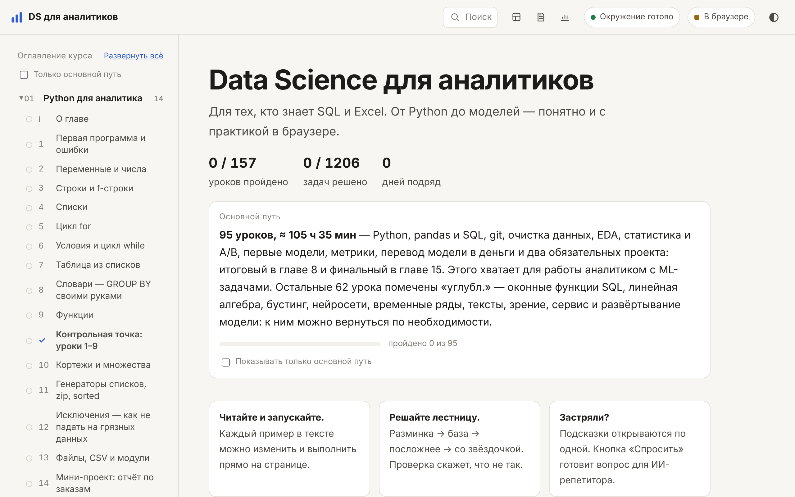
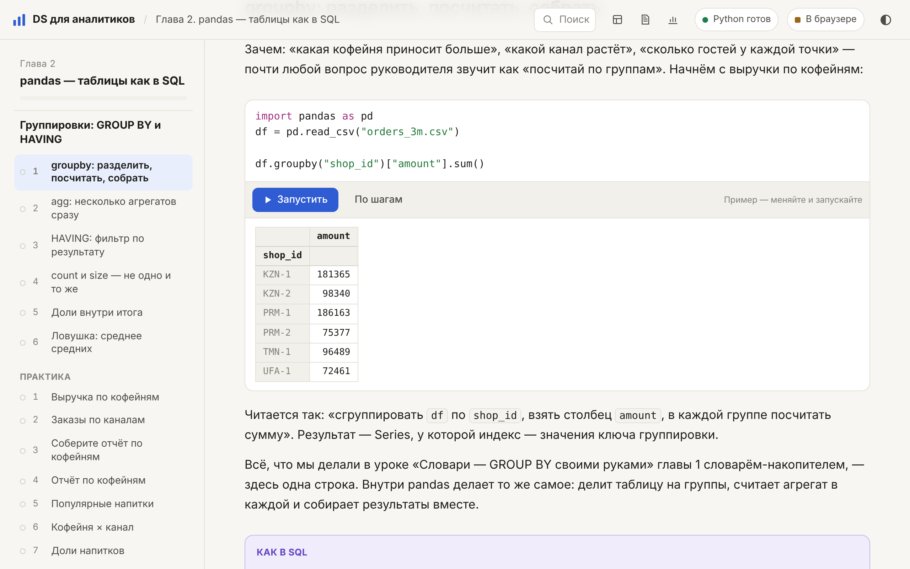
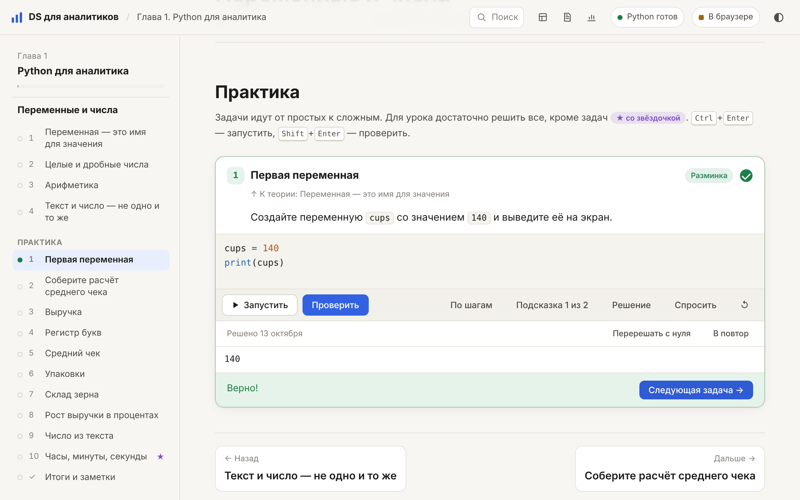
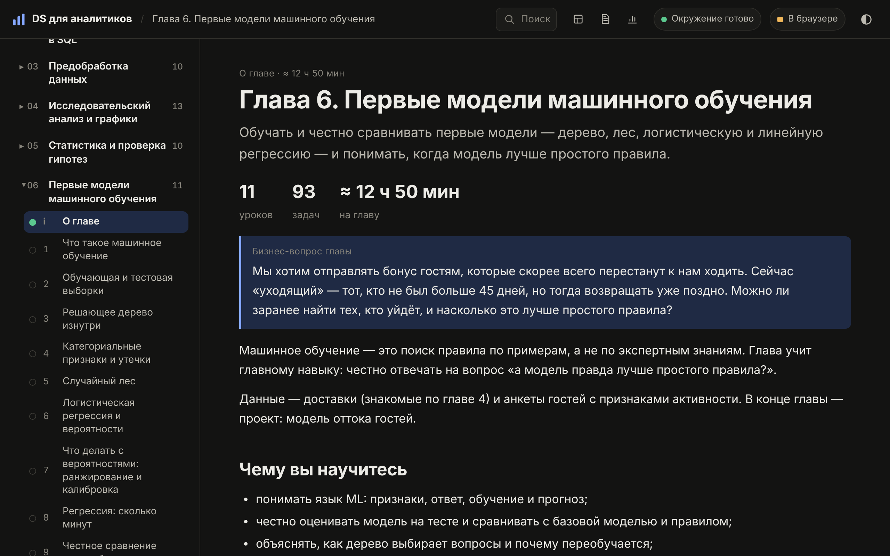

<div align="center">

# Data Science для аналитиков

**Открытый курс для тех, кто знает SQL и Excel: от первой строки на Python до моделей, которые приносят деньги.**
Код запускается прямо в браузере, задачи проверяются автоматически, ничего не нужно устанавливать.

### [Открыть курс →](https://perebevaska.github.io/kukushka/)




</div>

---

## Почему этот курс

- **Для аналитиков, а не для программистов.** Каждая новая вещь объясняется через то, что вы уже знаете: `groupby` — это `GROUP BY`, `merge` — `JOIN`, сводная таблица — та же, что в Excel. Рядом с кодом стоят блоки «Как в SQL».
- **Одна сквозная история.** Все данные, примеры и задачи — про сеть кофеен «Зерно»: выручка, гости, доставки, отток, A/B-тесты, отзывы. К концу курса это ваш «рабочий» бизнес, а не набор игрушечных датасетов.
- **Практика сразу.** Любой пример в тексте можно изменить и запустить на странице. Задачи идут лесенкой: разминка → база → посложнее → со звёздочкой. Проверка объясняет по-русски, что не так, а не просто пишет «неверно».
- **Честные модели и деньги.** Модель сравнивают с простым правилом, порог выбирают по прибыли, риск считают бутстрэпом, а итог переводят на язык руководителя.
- **Проекты для портфолио.** В каждой главе есть проект, а в конце — два больших, которые сдаются блокнотом и репозиторием на GitHub.

## Как это выглядит

<table>
<tr>
<td width="50%"><br><sub><b>Урок.</b> Пример меняется и запускается на странице, рядом — «как в SQL».</sub></td>
<td width="50%"><br><sub><b>Задача.</b> Проверка, подсказки по одной, решение, повторение через несколько дней.</sub></td>
</tr>
<tr>
<td colspan="2"><br><sub><b>Глава.</b> Бизнес-вопрос, чему научитесь, уроки и время. Есть тёмная тема.</sub></td>
</tr>
</table>

## Программа

**160 уроков, 1 317 задач, 15 глав.** Основной путь — 97 уроков (≈ 100 ч): с ним можно работать аналитиком на ML-задачах. Остальное — углубление по интересу, с пометкой «углубл.» и фильтром «Только основной путь».

| # | Глава | Уроков | Основной путь | Время |
|---|---|---:|---:|---:|
| 1 | Python для аналитика | 15 | 15 | ≈ 10 ч |
| 2 | pandas — таблицы как в SQL | 23 | 18 | ≈ 18 ч |
| 3 | Предобработка данных | 10 | 10 | ≈ 8 ч |
| 4 | Исследовательский анализ и графики | 14 | 12 | ≈ 13 ч |
| 5 | Статистика и проверка гипотез | 10 | 10 | ≈ 10 ч |
| 6 | Первые модели машинного обучения | 11 | 11 | ≈ 13 ч |
| 7 | Признаки, метрики и Pipeline | 13 | 12 | ≈ 13 ч |
| 8 | ML для бизнес-решений | 11 | 7 | ≈ 14 ч |
| 9 | Линейная алгебра для ML | 7 | — | ≈ 6 ч |
| 10 | Градиентный спуск и бустинг | 8 | — | ≈ 7 ч |
| 11 | Нейросети | 8 | — | ≈ 8 ч |
| 12 | Временные ряды | 6 | — | ≈ 4 ч |
| 13 | Тексты: от TF-IDF до LLM | 9 | — | ≈ 6 ч |
| 14 | Компьютерное зрение | 8 | — | ≈ 6 ч |
| 15 | Модель в работе: MLflow, FastAPI, Docker | 7 | 2 | ≈ 20 ч |

Время посчитано формулой по объёму теории, кода и задач и откалибровано по замерам двух пробных прохождений курса.

**Два обязательных проекта** завершают основной путь:

- **«Итоговый проект: от базы данных до рекомендаций»** (глава 8, ≈ 4 ч) — SQL-сборка признаков из пяти таблиц, три модели на кросс-валидации, порог по прибыли, портрет сегмента и рекомендации.
- **«Финальный проект курса»** (глава 15, ≈ 12 ч) — отток корпоративных клиентов по данным CRM: срезы во времени, признаки без утечек, модель, экономика звонков, артефакт модели с паспортом и скрипт расчёта списка.

## Быстрый старт

**Онлайн:** откройте [perebevaska.github.io/kukushka](https://perebevaska.github.io/kukushka/) — ничего ставить не нужно, прогресс хранится в браузере.

**Локально** (работает без интернета, прогресс сохраняется в файл): скачайте архив курса (или клонируйте репозиторий) и запустите:

| Система | Что сделать |
|---|---|
| **macOS** | двойной клик по `Курс.command` |
| **Windows** | двойной клик по `Курс-Windows.bat` — если Python нет, файл сам скачает переносной Python 3.12 (≈ 11 МБ, в систему ничего не ставится) |
| **Linux** | `./Курс-Linux.sh` (нужен `python3`) |
| **Вручную** | `uv run --no-project python tools/serve.py` или `python3 tools/serve.py` |

Откроется браузер с курсом на `http://127.0.0.1:8000`. Окно терминала не закрывайте, пока учитесь: это локальный сервер курса. Интернет не нужен — Python для браузера лежит в архиве.

> Двойной клик по `index.html` не подойдёт: без сервера Python в браузере не запускается.

**Прогресс** — решённые задачи, код, заметки, место остановки — сохраняется в папке `progress/` рядом с курсом, плюс ежедневные копии за 14 дней. На сайте без сервера (например, GitHub Pages) прогресс хранится в браузере, а на главной есть выгрузка и загрузка копии.

## Не только в браузере

- **Блокноты Jupyter.** Задачи каждой главы есть в блокноте `site/notebooks/chNN-practice.ipynb` с той же проверкой, что на сайте: ячейка `%%task`, затем Shift+Enter → «✓ Верно».
  ```sh
  uv run --with-requirements site/notebooks/requirements.txt jupyter lab site/notebooks
  ```
- **Дополнительные блокноты** (`site/notebooks/extra/`) — то, что в браузере не запускается: CatBoost и LightGBM, PyTorch, лемматизация `pymorphy3`, трансформеры, книга Excel.
- **Шаблон проекта** и `check_notebook.py` — самопроверка блокнота перед ревью: выполнение с чистого ядра, ошибки, абсолютные пути, разделы без выводов.

## Что ещё есть на сайте

- поиск по курсу (<kbd>⌘K</kbd> или <kbd>/</kbd>);
- шпаргалка — итоги уроков и сравнения с SQL, собирается автоматически;
- заметки к урокам с выгрузкой в Markdown;
- статистика: задачи по дням, серия, темп и прогноз окончания;
- интервальное повторение: задачи, решённые с подсказкой, возвращаются через несколько дней;
- контрольные точки и итоговые тесты глав;
- кнопка «Спросить» готовит вопрос для ИИ-репетитора с контекстом урока.

## Поделиться курсом

```sh
python3 tools/pack.py      # → dist/ds-course-ГГГГ-ММ-ДД.zip (≈ 90 МБ)
```

В архиве — готовый сайт с локальным Python для браузера, сервер, запускалки для трёх систем и инструкция `КАК ЗАПУСТИТЬ.txt`. Личный прогресс и исходники уроков в архив не попадают.

## Для авторов

Урок — один Markdown-файл: теория и задачи вместе. Формат и правила стиля — в [content/README.md](content/README.md).

```
content/
  course.yaml          программа: главы, уроки, минуты, основной путь (core)
  README.md            как писать уроки
  ch01/01-start.md     урок: теория + задачи (условие, заготовка, проверка, подсказки, решение, разбор)
  figures/             рисунки SVG
site/                  готовый сайт (собирается из content/, хранится в git — для GitHub Pages)
  assets/runner.js     Python (Pyodide) в Web Worker: страница не зависает, код можно остановить
  assets/harness.py    запуск кода, понятные ошибки на русском, помощники проверок
  data/                данные курса (генерируются tools/gen_*.py)
  notebooks/           блокноты Jupyter и dsc.py — проверка задач в Jupyter
tools/
  build.py             content/ → site/ (+ --check: проверка разметки)
  verify.mjs           эталоны задач проходят проверку, заготовки и неверные решения (negatives.json) — нет
  release_check.sh     всё перед публикацией: разметка, синхронность site/, задачи всех глав
  make_notebooks.py    блокноты глав (+ --test solution|starter chNN)
  core_refs.py         основной путь не должен опираться на углубления
  serve.py             локальный сервер + сохранение прогресса
  pack.py              архив курса
```

```sh
uv run tools/build.py                                  # собрать сайт
uv run tools/build.py --export build/tasks.json
node tools/verify.mjs build/tasks.json                 # проверить все задачи и примеры
node tools/verify.mjs build/tasks.json 02-numbers      # только один урок
python3 tools/make_notebooks.py --test solution ch05   # блокноты главы: эталоны проходят
sh tools/release_check.sh                              # перед публикацией (на закоммиченном дереве)
```

Карта переносов прогресса (старый ключ задачи → новый) хранится в `content/moved.json`: при делении урока или переименовании задачи добавьте туда строку, иначе у учеников пропадут отметки. Сборка падает, если старый ключ совпал с живой задачей или адресата нет.

Принципы: каждое число в тексте посчитано кодом; термин объясняется до первой задачи, где он нужен; данные — свои, синтетические или из открытых источников с совместимой лицензией. Тексты, задачи и датасеты сторонних курсов не используются.

## Лицензии

Тексты, задачи, примеры и данные курса — [CC BY-SA 4.0](https://creativecommons.org/licenses/by-sa/4.0/deed.ru). Код — MIT, см. [LICENSE](LICENSE). Сторонние компоненты: CodeMirror — MIT, Pyodide — MPL-2.0.

<div align="center"><sub>© 2026 Dmitrii Kormin</sub></div>
